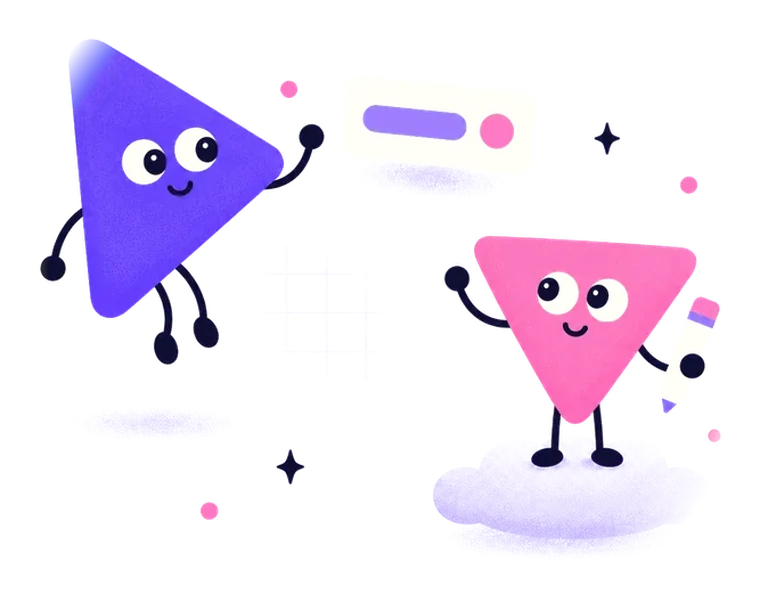

<p align="center">
  <picture>
    <source media="(prefers-color-scheme: dark)" srcset="assets/pego-lockup-reversed.svg">
    
  </picture>
</p>

<p align="center">
  <b>Agent-first design that lives in your repo.</b><br>
  Describe it. Watch it. Make it yours.
</p>

<p align="center">
  <a href="https://github.com/pego-ink/pego-releases/releases"><b>Download for macOS, Windows and Linux</b></a> ·
  <a href="https://changelog.pego.ink">What's new</a>
</p>

<picture>
  <source media="(prefers-color-scheme: dark)" srcset="assets/hero-dark.webp">
  
</picture>

Pego is an AI-native design editor. Describe the screen you want, an agent designs it on a real canvas, and you
keep editing by hand. Your designs are `.pego` files: plain JSON that lives in your repo, right next to the code.

<table>
  <tr>
    <td align="center" width="33%">
      <picture>
        <source media="(prefers-color-scheme: dark)" srcset="assets/welcome-dark.webp">
        
      </picture>
      <br><b>The agent designs, you decide</b><br>
      Anything the agent can do, you can do too.
    </td>
    <td align="center" width="33%">
      <picture>
        <source media="(prefers-color-scheme: dark)" srcset="assets/folder-dark.webp">
        
      </picture>
      <br><b>Files over servers</b><br>
      Diffable JSON in git. No Pego account.
    </td>
    <td align="center" width="33%">
      <picture>
        <source media="(prefers-color-scheme: dark)" srcset="assets/done-dark.webp">
        
      </picture>
      <br><b>Every change is reversible</b><br>
      One agent step is one undo. A whole run rolls back in one click.
    </td>
  </tr>
</table>

## Download

Pego is in open beta. Grab the newest build from **[Releases](https://github.com/pego-ink/pego-releases/releases)**.
There is no stable release yet, so the builds there are nightlies, marked _Pre-release_.

| Platform              | File                                                                     |
| --------------------- | ------------------------------------------------------------------------ |
| macOS (Apple silicon) | `Pego-<version>-arm64.dmg`                                               |
| macOS (Intel)         | `Pego-<version>-x64.dmg`                                                 |
| Windows (x64)         | `Pego-<version>-win-x64.exe`                                             |
| Linux (x64)           | `…-linux-x86_64.AppImage`, or `.deb` (amd64), `.rpm`, `.pacman`, `.tar.gz` |
| Linux (arm64)         | `…-linux-arm64.AppImage`, or `.deb`, `.rpm` (aarch64), `.pacman`, `.tar.gz` |

The macOS app is signed and notarized. Every release has a `SHA256SUMS.txt` to check your download against.

## Updates

The macOS app, the Windows installer and the Linux AppImage update themselves. They download a new version in the
background and tell you when it is ready; one click restarts into it. Pick how fresh you like it in
**Settings › About & Updates**:

- **Stable**: tested releases. The first one is on its way.
- **Nightly**: built every night from the latest work. New things first, and now and then a rough edge.

The `.deb`, `.rpm`, `.pacman`, `.tar.gz` and `.zip` builds don't update themselves: download the new one by hand.

## Bring your own agent


Pego works with the coding agent you already use, signed in with your own account: **Claude Code, Codex,
opencode, Qwen Code, Gemini CLI, Cursor Agent, Copilot CLI, Kiro CLI, ZCode, Goose, Amp, Cline and Kimi Code**.
Or paste an Anthropic API key; it stays on your computer and goes only to Anthropic.

With Claude Code in a terminal you can design from there too. With Pego open, run once:

```bash
claude mcp add --transport http pego http://127.0.0.1:4519/mcp
```

Then ask for a screen and watch it appear on the canvas.

<br clear="right">

## Feedback

Found a bug or have an idea? **[Open an issue](https://github.com/pego-ink/pego-releases/issues)**, or use
**Settings › About › Report an issue** in the app. Everything that changed is on
**[changelog.pego.ink](https://changelog.pego.ink)**.

<p align="center">
  <sub>Wing (the agent) and Stroke (you) are the Pego Duo, the two shapes of the Pego logo.</sub>
</p>
